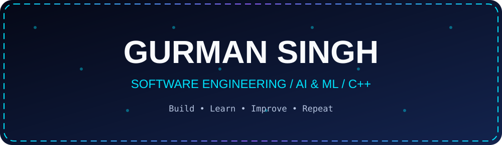
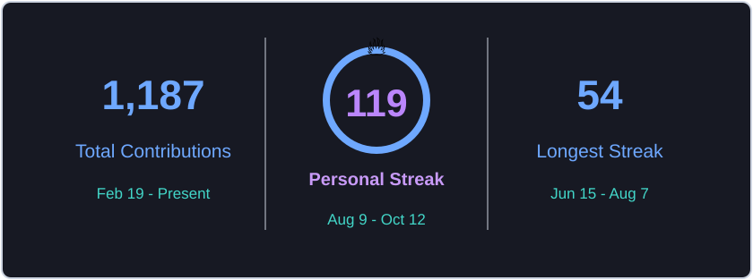
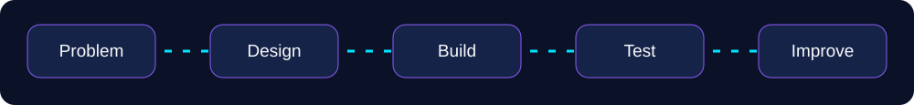
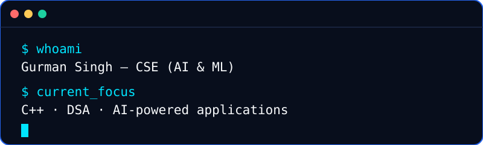

<div align="center">




<br>


</div>

---

# 💫 About Me


🚀 B.Tech CSE (AI & ML)

💡 Passionate about Artificial Intelligence & Full Stack Development

🌱 Currently learning:
- Machine Learning
- Deep Learning
- Next.js
- System Design

🎯 Goal:
- Become a highly skilled Software Engineer
- Secure a top tech role
- Contribute to impactful open-source projects

⚡ Fun Fact:
> "Consistency beats motivation."

---

# 🌐 Connect With Me

<p align="center">
<a href="https://github.com/GurmanSingh7"></a>
<a href="https://www.linkedin.com/in/gurmansingh07/"></a>
<a href="mailto:gurman.singh.dev1@gmail.com"></a>
<a href="https://leetcode.com/u/GurmanSingh7/"></a>
</p>

---

<div align="center">

# ⚡ SKILL TREE UNLOCKED


</div>

---

## ⚔️ Frontend Weapons

<p align="center">
  
  
  
  
  
  
  
  
  
</p>

---

## 🛡️ Backend Armor

<p align="center">
  
  
  
  
  
  
  
</p>

---

## 🔮 Magic Spells (Languages)

<p align="center">
  
  
  
</p>

---

## ⚙️ Power Tools

<p align="center">
  
  
  
  
  
  
  
  
</p>

---

<div align="center">

## 🚀 GurmanSingh7's Developer Journey

```txt
Frontend ████████████████ 100%
Backend  ██████████████░░ 85%
DSA      ████████████░░░░ 75%
DevOps   ██████████░░░░░░ 65%
AI/ML    █████████████░░░ 80%
```

</div>

<p align="center"></p>

---

# 💻 Tech Stack

<div align="center">

</div>

---

# 🚀 GitHub Analytics

<!-- PERSONAL_STREAK_START -->
<p align="center">
  
</p>
<!-- PERSONAL_STREAK_END -->

<br>

---

# 📈 Contribution Graph

<div align="center">

</div>

---

---

# 🔥 Current Focus

```yaml
Learning:
  - Artificial Intelligence
  - Machine Learning
  - Deep Learning
  - Full Stack Development

Building:
  - AI Powered Applications
  - Modern Web Platforms

Goals 2026:
  - Open Source Contributions
  - Strong DSA
  - Internship
  - Placement Preparation
```

---

# 📊 Profile Views

<div align="center">

</div>

---

<div align="center">

## 🚀 "Code. Learn. Build. Repeat."


</div>

---

# 🧭 Engineering Workflow

<div align="center">

</div>

---

# 💻 Developer Terminal

<div align="center">

</div>

---

<div align="center">

</div>
